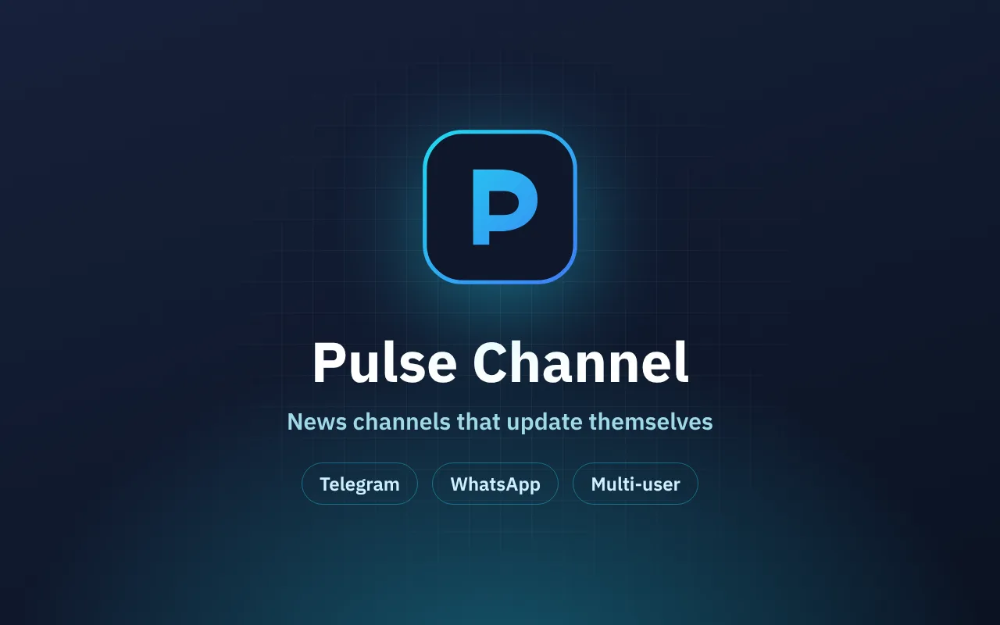

# Pulse Channel

**Telegram and WhatsApp news channels that update themselves — from one screen.**

Channel command center

## Overview

A multi-user system running four engines: Telegram news, Telegram member growth, WhatsApp news and WhatsApp adds — each user in an isolated environment.

| The challenge | The solution |
| --- | --- |
| Channel owners post news by hand on several platforms and keep a separate script for every task. | I unified everything into one command center: a Node.js server running Python (Telethon) and Node (Baileys) workers, with a React UI for setup and monitoring. |

## Key features

- Automatic news publishing to Telegram and WhatsApp
- Channel and group growth on both platforms
- Fully isolated data and sessions per user
- PWA in Hebrew, English, Russian and Arabic

> **Outcome:** Running in production on a VPS with PM2 and Nginx.

## Tech stack

`Node.js` `React` `PWA` `Python` `Telethon` `Baileys` `MySQL`

## My role

Product spec, UX, full-stack development, deployment and ongoing support — built end-to-end by me under **[AZToDev](https://aztodev.com)**.

## About the code

This is a commercial product, so the source code is private. This repository is a public showcase. For a live demo or a technical walkthrough, reach out:

[aztodev.com](https://aztodev.com) · [LinkedIn](https://www.linkedin.com/in/zion-amar) · amzion24@gmail.com

---

### בעברית

**Pulse Channel** — ערוצי חדשות בטלגרם ובוואטסאפ שמתעדכנים לבד — ממסך אחד.

מערכת רב־משתמשים שמנהלת ארבעה מנועים: חדשות לטלגרם, הוספת חברים בטלגרם, חדשות לוואטסאפ והוספה בוואטסאפ — כל משתמש עם סביבה מבודדת משלו.

